## Hi, I'm Nedim

Software Engineer at **[Mastery](https://mastery.ba)**, working on **[ProFlow](https://proflow.ba)**, an ERP for CNC manufacturing that covers material tracking, production planning and machine workflows. Based in Maglaj, Bosnia and Herzegovina.

### Tech stack

<table>
  <tr>
    <td><b>At work</b></td>
    <td>
      
      
    </td>
  </tr>
  <tr>
    <td><b>Web</b></td>
    <td>
      
      
      
      
    </td>
  </tr>
  <tr>
    <td><b>Workflow</b></td>
    <td>
      
      
      
    </td>
  </tr>
</table>

### Activity

<picture>
  <source media="(prefers-color-scheme: dark)" srcset="assets/stats-dark.svg" />
  
</picture>
<picture>
  <source media="(prefers-color-scheme: dark)" srcset="assets/languages-dark.svg" />
  
</picture>

<picture>
  <source media="(prefers-color-scheme: dark)" srcset="assets/activity-dark.svg" />
  
</picture>

Most of my work lives in private company repositories. It counts toward the activity numbers, and languages are measured by the lines I wrote in my own commits, generated code excluded. Charts refresh daily.
